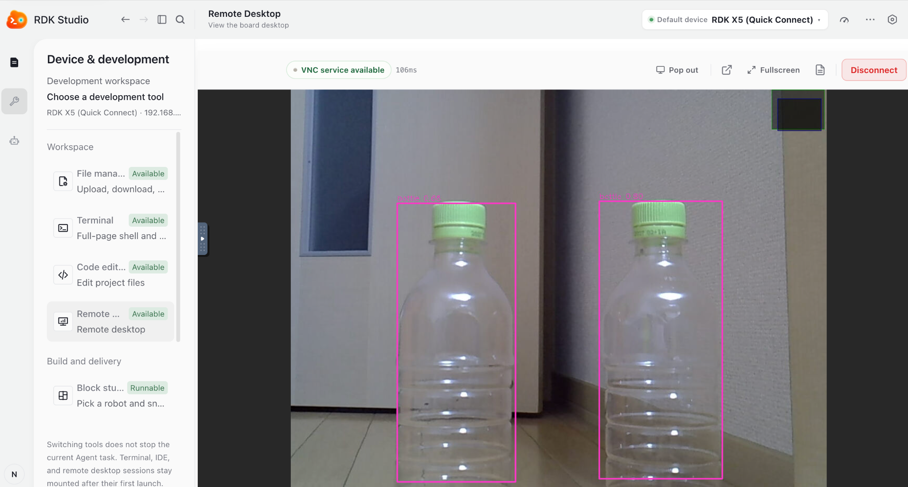

# RDK Challenge 2026 — Stage 1

## Overview

I set up an RDK X5, connected a USB webcam, and ran a YOLO object detection demo on the board. The demo detected two bottles.

## Hardware and software

- D-Robotics RDK X5
- microSD card with RDK OS 3.5.0 Desktop
- USB webcam (USB camera interface)
- Mac with RDK Studio, connected to the board using Type-C direct and SSH
- Python 3 and the preinstalled USB camera YOLO demo; additional dependencies are described in the demo's README.

## Setup and connection

1. Used RDK Studio to flash the RDK OS 3.5.0 Desktop image to the microSD card and booted the RDK X5.
2. Connected the board to the Mac using Type-C direct in RDK Studio and verified an SSH terminal session.
3. Connected the board to Wi-Fi and confirmed internet access using `ping`.
4. Connected a USB webcam; `/dev/video0` and `/dev/video1` appeared. A camera capture test succeeded.

## AI demo

From a terminal in the RDK remote desktop:

```bash
cd /app/pydev_demo/07_usb_camera_sample
python3 usb_camera_yolov5x.py
```

The camera feed displayed bounding boxes and `bottle` labels for two bottles. The demo uses the provided RDK sample; the detection was run on my RDK X5.

## Troubleshooting

- Flashing initially failed because the Mac did not have enough free storage to decompress the image. Freeing space and retrying allowed flashing to complete.
- A previous attempt failed because the downloaded compressed image had been deleted. The image was restored before retrying.
- The board initially could not resolve internet hostnames. Connecting the RDK X5 to Wi-Fi resolved the connectivity check.
- The Raspberry Pi camera cable did not fit the RDK camera connector, so I used a USB webcam instead.

## Evidence and submission

- Flash and SSH screenshots: to be added.
- USB camera and object detection: see the image below.


- Discord Stage 1 update and official showcase submission: to be added.

Reference: [Robotics Dream Keeper Challenge 2026 Winter](https://github.com/D-Robotics/Robotics-Dream-Keeper-Challenge-Winter).
