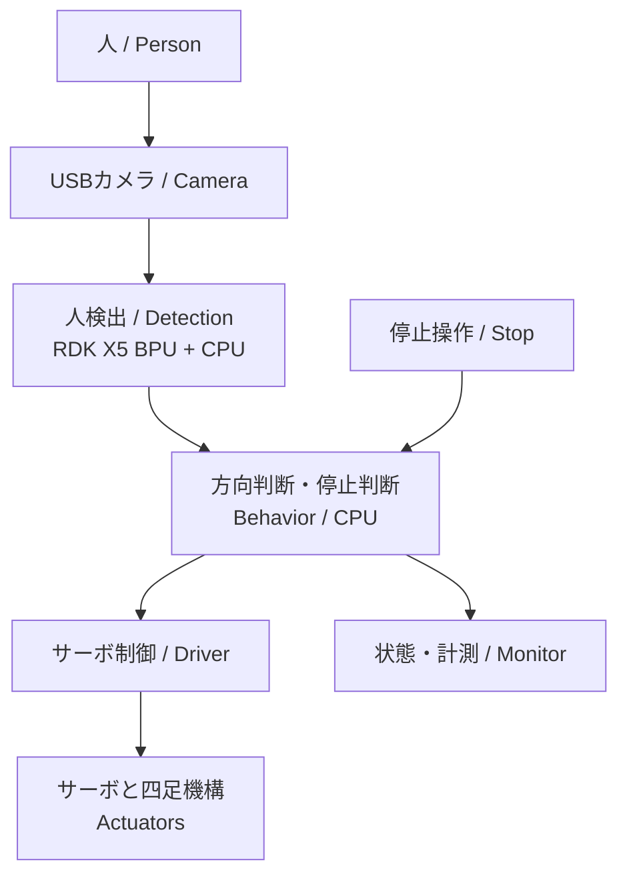
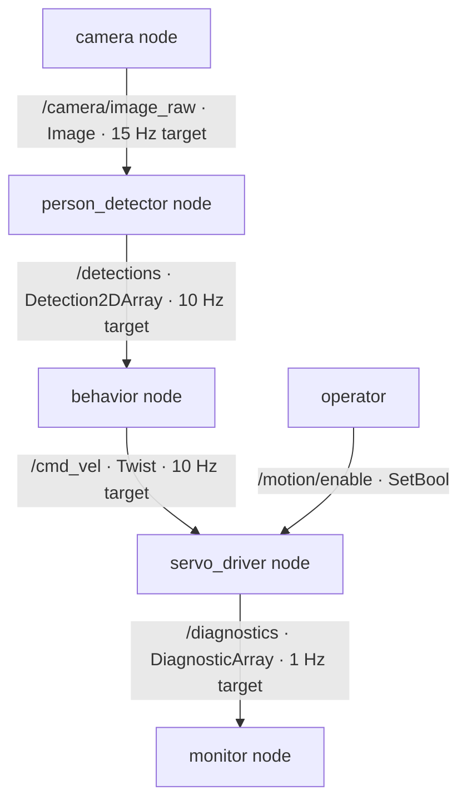

# Pochaken (ぽちゃ犬) — Stage 2 architecture / 設計図

> Design proposal, not an implemented system. Numbers, hardware and interfaces below are initial targets to be validated.
> これは設計案です。Stage 1のボトル検出以外は未実装・未検証です。

## Concept / 目指す姿

A small four-legged companion that stays near a person and aims to follow them. In the future it may provide conversation and helpful information. The present challenge focuses on perception and movement.
人と一緒に過ごす小さな四足歩行の相棒。将来の会話や情報提供は構想で、今回の焦点は人の認識と移動です。

## System data flow / 全体の流れ

The servo power supply and PWM interface remain to be selected. Person detection does not identify a specific individual. Monocular bounding-box size is not a reliable distance or collision sensor; a safe stopping and obstacle strategy remains open.

## Proposed ROS 2 graph / ROS 2での接続案

Rates are planned targets, not measured results. `/motion/enable` is a planned service. The servo driver must translate movement commands into a suitable gait; joint count and PWM implementation are undecided.

| Module | Input → output | Allocation and failure handling |
|---|---|---|
| camera | USB video → image | CPU; camera loss stops fresh images |
| person_detector | image → person boxes | BPU inference, CPU preprocessing/postprocessing; empty or stale result leads to stop |
| behavior | boxes → movement command | CPU; missing target, stale data or stop request generates a stop command |
| servo_driver | command → PWM | CPU and PWM hardware to be selected; timeout disables movement, explicit re-enable planned |
| monitor | diagnostics → display/log | CPU; logs detection, timing and stop reasons |

## Hardware and open questions / 部品と未確認事項

- Available: RDK X5, USB camera, three SG90/MG90S servos (exact breakdown to confirm).
- To determine: leg mechanism, servo number and load capacity, body weight, PWM interface, adequate separate servo power, battery, and obstacle/distance sensing.
- RDK X5 and camera weight may prevent a palm-sized walking system; measure before deciding whether the computer can be carried onboard.
- Bench-test the mechanism first. Do not run unattended; stop tests if loss detection or stopping does not work.

## Progress / 現状

Stage 1: RDK X5 and USB camera connected; sample object detection recognized bottles. Person detection, ROS 2 integration, servo control, walking, and following are planned and not yet demonstrated.
